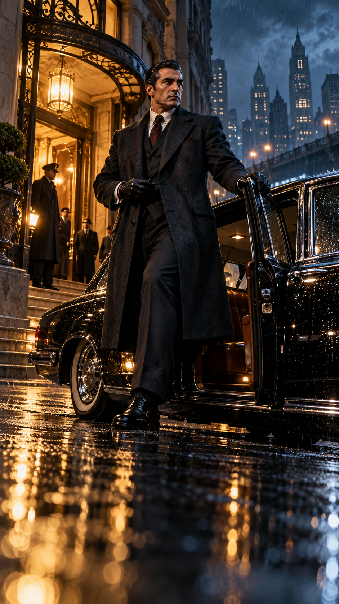
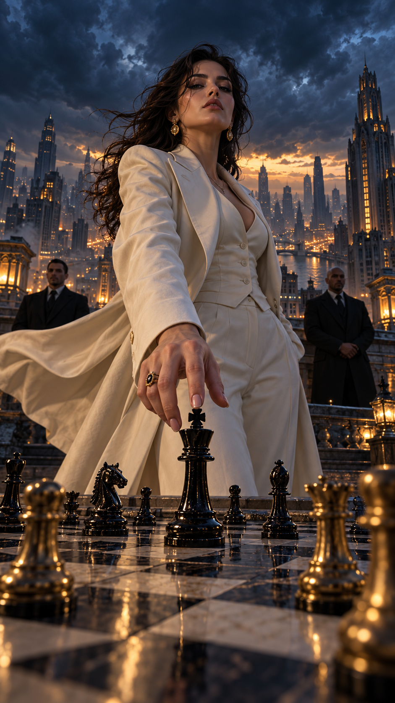

# 40 AI Video Concepts

8 categories · 40 completed videos · Portrait first frames · Detailed prompts for 5-second clips

Use each attached image as the source image in your image-to-video tool. Set duration to 5 seconds and portrait 9:16.

## Mafia boss

### Rain Arrival



[Watch video 1](videos/mafia-01.mp4) · [Download MP4 + WebP](downloads/mafia-01.zip)

**Video prompt**

```text
Create a 5-second, 9:16 portrait image-to-video clip. Use the supplied image as the exact first frame; do not replace it with a new opening shot. Preserve its composition, characters, costumes, setting, lighting, and visible objects at 0.0 seconds.

Opening frame: The suited boss is stepping from a black vintage car outside a glowing private club in heavy night rain.

0.0–1.0 seconds: Raindrops streak across the car roof; he pauses with one polished shoe on the pavement and adjusts his glove.
1.0–3.6 seconds: He closes the door with a decisive click and walks toward the entrance; the camera tracks backward close to the wet ground, catching long gold reflections.
3.6–5.0 seconds: The doorman opens the doors just as he reaches them. Warm light silhouettes him; he gives one quiet sideways glance to camera before disappearing inside. Hold the final image clearly for the last 0.3 seconds.

Camera and visual style: Low continuous tracking shot; grounded noir realism with deep navy rain and amber club light. Sound, if supported: Rain, car-door thud, footsteps through water, restrained bass pulse. Keep the movement brisk but readable, prioritizing one main action and a clear final payoff. Keep character identities and object geometry consistent. One continuous shot, with no cuts, teleporting, face changes, extra limbs, unintended text, or watermarks.
```

### Checkmate at Dusk



[Watch video 1](videos/mafia-02.mp4) · [Download MP4 + WebP](downloads/mafia-02.zip)

**Video prompt**

```text
Create a 5-second, 9:16 portrait image-to-video clip. Use the supplied image as the exact first frame; do not replace it with a new opening shot. Preserve its composition, characters, costumes, setting, lighting, and visible objects at 0.0 seconds.

Opening frame: A woman in an ivory suit towers over a rooftop chessboard, fingertips poised above the black king; two guards and a stormy city are behind her.

0.0–1.0 seconds: Wind lifts her coat and hair. Her fingers settle on the black king as distant thunder rolls.
1.0–3.6 seconds: She slowly tips the king onto the board. The camera circles the piece at table height while lightning briefly reveals both silent bodyguards.
3.6–5.0 seconds: As the king lands, focus snaps from the fallen piece to her unreadable face; she turns and walks away while the city lights flicker on behind her. Hold the final image clearly for the last 0.3 seconds.

Camera and visual style: One controlled low orbit and rack focus; cinematic blue-hour noir, no magic effects on the chessboard. Sound, if supported: Wind, single chess-piece knock, low thunder, one deep musical note. Keep the movement brisk but readable, prioritizing one main action and a clear final payoff. Keep character identities and object geometry consistent. One continuous shot, with no cuts, teleporting, face changes, extra limbs, unintended text, or watermarks.
```
