# 40 AI Video Concepts

8 categories · 40 completed videos · Portrait first frames · Detailed prompts for 5-second clips

Use each attached image as the source image in your image-to-video tool. Set duration to 5 seconds and portrait 9:16.

## Mafia boss

### Rain Arrival


[Watch video 1](videos/mafia-01.mp4) · [Download MP4 + WebP + PNG](downloads/mafia-01.zip)

**Video prompt**

```text
Opening frame: The suited boss is stepping from a black vintage car outside a glowing private club in heavy night rain.

0.0–1.0 seconds: Raindrops streak across the car roof; this person pauses with one polished shoe on the pavement and adjusts this person's glove.
1.0–3.6 seconds: This person closes the door with a decisive click and walks toward the entrance; the camera tracks backward close to the wet ground, catching long gold reflections.
3.6–5.0 seconds: The door attendant opens the doors just as this person reaches them. Warm light silhouettes this person; this person gives one quiet sideways glance to camera before disappearing inside. Hold the final image clearly for the last 0.3 seconds.

Camera and visual style: Low continuous tracking shot; grounded noir realism with deep navy rain and amber club light. Sound, if supported: Rain, car-door thud, footsteps through water, restrained bass pulse. Keep the movement brisk but readable, prioritizing one main action and a clear final payoff. Keep character identities and object geometry consistent. One continuous shot, with no cuts, teleporting, face changes, extra limbs, unintended text, or watermarks.
```

### Checkmate at Dusk


[Watch video 1](videos/mafia-02.mp4) · [Download MP4 + WebP + PNG](downloads/mafia-02.zip)

**Video prompt**

```text
Opening frame: This person in an ivory suit towers over a rooftop chessboard, fingertips poised above the black king; two guards and a stormy city are behind this person.

0.0–1.0 seconds: Wind lifts this person's coat and hair. This person's fingers settle on the black king as distant thunder rolls.
1.0–3.6 seconds: This person slowly tips the king onto the board. The camera circles the piece at table height while lightning briefly reveals both silent bodyguards.
3.6–5.0 seconds: As the king lands, focus snaps from the fallen piece to this person's unreadable face; this person turns and walks away while the city lights flicker on behind this person. Hold the final image clearly for the last 0.3 seconds.

Camera and visual style: One controlled low orbit and rack focus; cinematic blue-hour noir, no magic effects on the chessboard. Sound, if supported: Wind, single chess-piece knock, low thunder, one deep musical note. Keep the movement brisk but readable, prioritizing one main action and a clear final payoff. Keep character identities and object geometry consistent. One continuous shot, with no cuts, teleporting, face changes, extra limbs, unintended text, or watermarks.
```

### The Red Envelope


[Watch video 1](videos/mafia-03.mp4) · [Download MP4 + WebP + PNG](downloads/mafia-03.zip)

**Video prompt**

```text
Opening frame: A boss in black velvet sits in an ornate opera box, looking at a sealed red envelope while a performance continues below.

0.0–1.0 seconds: The chandelier sways almost imperceptibly. This person breaks the wax seal with this person's thumb without looking away from the stage.
1.0–3.6 seconds: This person unfolds the paper; keep it blank or unreadable. The orchestra stops mid-phrase and the stage spotlight suddenly goes dark.
3.6–5.0 seconds: This person looks up toward the empty stage, then gives the slightest knowing smile as the red curtains begin to close below. Hold the final image clearly for the last 0.3 seconds.

Camera and visual style: Slow push from medium frame to close portrait; luxurious gold-and-crimson suspense, one continuous shot. Sound, if supported: Orchestra cuts to silence, paper crackle, chandelier crystals, low suspense hit. Keep the movement brisk but readable, prioritizing one main action and a clear final payoff. Keep character identities and object geometry consistent. One continuous shot, with no cuts, teleporting, face changes, extra limbs, unintended text, or watermarks.
```

### The Casino Entrance

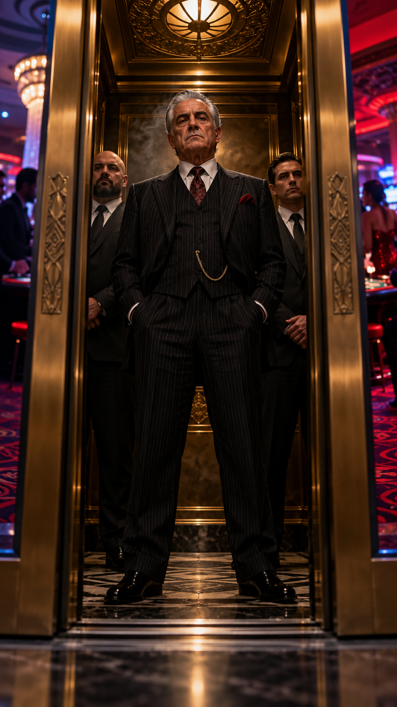

[Watch video 1](videos/mafia-04.mp4) · [Download MP4 + WebP + PNG](downloads/mafia-04.zip)

**Video prompt**

```text
Opening frame: A silver-haired boss stands with two associates in a vintage brass elevator opening onto a red-lit casino.

0.0–1.0 seconds: The brass doors finish sliding apart; casino lights and smoke reflect across the boss's pinstripe suit.
1.0–3.6 seconds: Without rushing, this person steps forward while the two associates follow a pace behind. The camera glides backward, maintaining this person's centered silhouette.
3.6–5.0 seconds: Nearby casino patrons turn and quietly part to create a clear path. End on this person's shoes crossing into a pool of red light, then tilt up to this person's steady gaze. Hold the final image clearly for the last 0.3 seconds.

Camera and visual style: Symmetrical continuous dolly, polished gangster-film realism, rich gold and crimson. Sound, if supported: Elevator bell, casino ambience softens, measured footsteps, restrained cinematic bass. Keep the movement brisk but readable, prioritizing one main action and a clear final payoff. Keep character identities and object geometry consistent. One continuous shot, with no cuts, teleporting, face changes, extra limbs, unintended text, or watermarks.
```

### The Last Candle


[Watch video 1](videos/mafia-05.mp4) · [Download MP4 + WebP + PNG](downloads/mafia-05.zip)

**Video prompt**

```text
Opening frame: This mafia boss sits at the end of a long candlelit restaurant table, holding a spent match, with rain against the windows.

0.0–1.0 seconds: This person slowly lowers the spent match beside the white chess knight; the camera starts at table height with flames receding into depth.
1.0–3.6 seconds: This person blows once. The candle flames extinguish in a fast sequence down the table, sending thin trails of smoke toward camera.
3.6–5.0 seconds: In the sudden blue darkness, passing headlights sweep across this person's face. This person remains perfectly still and smiles almost imperceptibly. Hold the final image clearly for the last 0.3 seconds.

Camera and visual style: One elegant table-level push-in; noir contrast between warm flame and cold rain; no supernatural particles. Sound, if supported: Soft breath, successive candle pops, distant traffic, one low cello note. Keep the movement brisk but readable, prioritizing one main action and a clear final payoff. Keep character identities and object geometry consistent. One continuous shot, with no cuts, teleporting, face changes, extra limbs, unintended text, or watermarks.
```

## Anime

### Moonblade Awakening

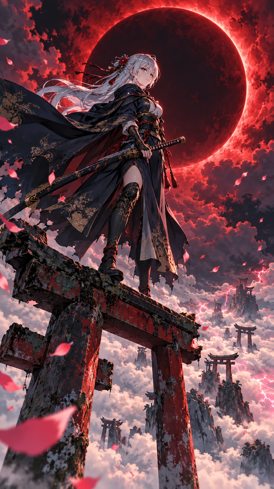

[Watch video 1](videos/anime-01.mp4) · [Download MP4 + WebP + PNG](downloads/anime-01.zip)

**Video prompt**

```text
Opening frame: This silver-haired person stands on a broken torii gate beneath a huge red eclipse, hand poised at this person's sheathed blade.

0.0–1.0 seconds: Petals and cloak snap in an unnatural wind. The eclipse brightens around its rim as the camera rises from below the gate.
1.0–3.6 seconds: This person draws the blade in one clean arc; a narrow crimson light trail cuts through the clouds while this person remains balanced on the beam.
3.6–5.0 seconds: Clouds split to reveal multiple distant gates rising above the cloud sea. This person re-sheathes the sword as petals rush past the lens. Hold the final image clearly for the last 0.3 seconds.

Camera and visual style: Fluid 2D animated film motion, bold hand-painted effects, one dramatic low-to-high camera move. Sound, if supported: Wind, sword ring, brief silence at the draw, resonant orchestral impact. Keep the movement brisk but readable, prioritizing one main action and a clear final payoff. Keep character identities and object geometry consistent. One continuous shot, with no cuts, teleporting, face changes, extra limbs, unintended text, or watermarks.
```

### Neon Courier Jump

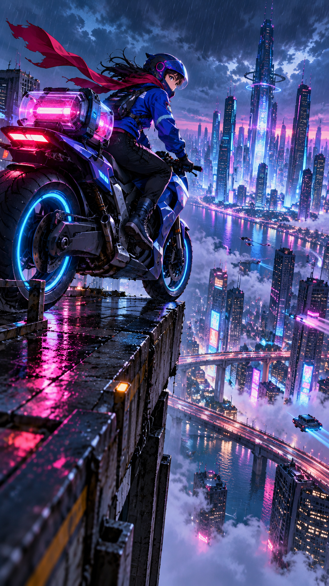

[Watch video 1](videos/anime-02.mp4) · [Download MP4 + WebP + PNG](downloads/anime-02.zip)

**Video prompt**

```text
Opening frame: An anime courier on a futuristic motorbike balances at the edge of a wet high roadway, facing a neon city.

0.0–1.0 seconds: Rain beads on this person's visor and the glowing delivery capsule. The rear wheel spins; this person's scarf lashes in the wind.
1.0–3.6 seconds: This person launches cleanly off the ledge. The camera follows beside the bike over a dizzying gap, with neon streets and cloud layers far below.
3.6–5.0 seconds: This person lands on a lower elevated road in a burst of rain spray and accelerates away, leaving cyan and magenta reflections behind. Hold the final image clearly for the last 0.3 seconds.

Camera and visual style: One continuous side-tracking action shot; kinetic 2D anime perspective, no impossible bike deformation. Sound, if supported: Engine surge, wind rush, landing splash, energetic percussion. Keep the movement brisk but readable, prioritizing one main action and a clear final payoff. Keep character identities and object geometry consistent. One continuous shot, with no cuts, teleporting, face changes, extra limbs, unintended text, or watermarks.
```

### Mecha Dawn Launch

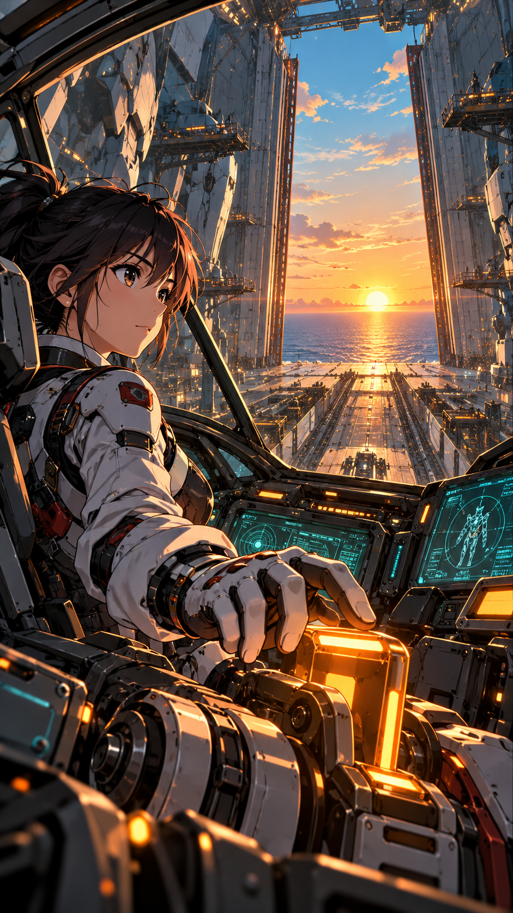

[Watch video 1](videos/anime-03.mp4) · [Download MP4 + WebP + PNG](downloads/anime-03.zip)

**Video prompt**

```text
Opening frame: A young pilot sits in a detailed cockpit, hand hovering above the orange launch lever; hangar doors frame the ocean sunrise.

0.0–1.0 seconds: Displays pulse awake. This person takes a breath, locks this person's gaze on the opening, and grips the glowing lever.
1.0–3.6 seconds: This person pulls it. The cockpit shudders; huge mechanical launch rails race past outside and sunrise flares across the canopy.
3.6–5.0 seconds: The mecha surges out over the ocean. From inside the cockpit, the horizon drops as it climbs; this person gives a brief determined smile. Hold the final image clearly for the last 0.3 seconds.

Camera and visual style: Remain inside the cockpit in a single shot; layered hand-drawn mecha animation with coherent controls and parallax. Sound, if supported: Lever clunk, turbine swell, mechanical rumble, triumphant synth-orchestra hit. Keep the movement brisk but readable, prioritizing one main action and a clear final payoff. Keep character identities and object geometry consistent. One continuous shot, with no cuts, teleporting, face changes, extra limbs, unintended text, or watermarks.
```

### Dragon Shadow

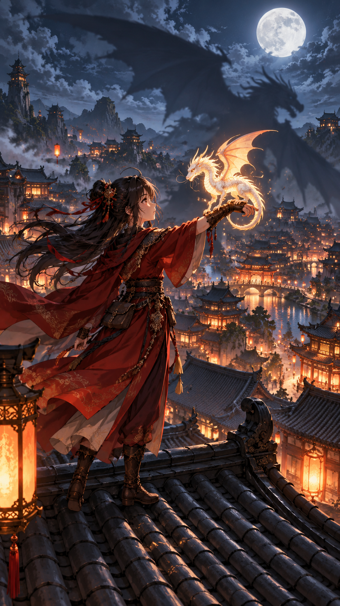

[Watch video 1](videos/anime-04.mp4) · [Download MP4 + WebP + PNG](downloads/anime-04.zip)

**Video prompt**

```text
Opening frame: This person on a lantern-lit rooftop holds a tiny luminous dragon on this person's wrist; a gigantic dragon shadow crosses the moonlit city.

0.0–1.0 seconds: The little dragon blinks and unfurls its glowing wings. This person's hair and red robe ripple in the rooftop wind.
1.0–3.6 seconds: It leaps from this person's wrist, drawing a ribbon of warm light as it spirals upward toward the huge shadow passing across the moon.
3.6–5.0 seconds: The shadow resolves into an enormous dragon gliding above the lantern city; this person looks up in awe as its wings briefly eclipse the moon. Hold the final image clearly for the last 0.3 seconds.

Camera and visual style: One graceful camera tilt from wrist to sky; painterly anime fantasy with consistent dragon design. Sound, if supported: Wing flutter, lantern chimes, deep distant wingbeat, rising orchestral wonder. Keep the movement brisk but readable, prioritizing one main action and a clear final payoff. Keep character identities and object geometry consistent. One continuous shot, with no cuts, teleporting, face changes, extra limbs, unintended text, or watermarks.
```

### Impossible Save

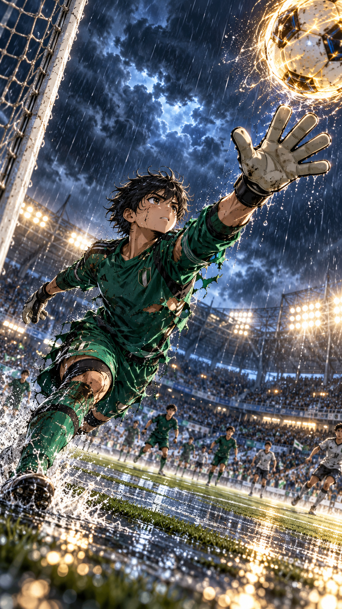

[Watch video 1](videos/anime-05.mp4) · [Download MP4 + WebP + PNG](downloads/anime-05.zip)

**Video prompt**

```text
Opening frame: A young goalkeeper in green reaches toward a glowing football in heavy rain, goalpost and crowd behind.

0.0–1.0 seconds: Rain seems to slow as the ball approaches the glove; the camera pushes toward the hand and the goal line.
1.0–3.6 seconds: Fingertips contact the ball. A ring of golden energy and spray bursts outward, while the goalkeeper twists to redirect it.
3.6–5.0 seconds: The ball clears the crossbar by inches. The goalkeeper lands in a splash; stadium lights flare and the crowd erupts. Hold the final image clearly for the last 0.3 seconds.

Camera and visual style: Sports-anime exaggeration with readable ball path and one continuous high-energy camera move. Sound, if supported: Rain, heartbeat pause, glove impact, explosive crowd roar. Keep the movement brisk but readable, prioritizing one main action and a clear final payoff. Keep character identities and object geometry consistent. One continuous shot, with no cuts, teleporting, face changes, extra limbs, unintended text, or watermarks.
```

## Ghibli

### Cloud Train Arrival

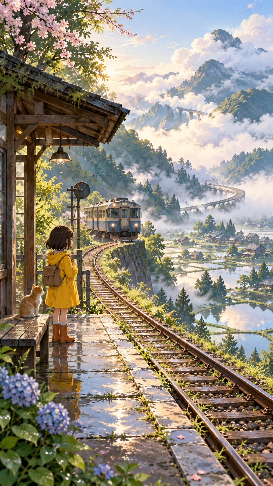

[Watch video 1](videos/ghibli-01.mp4) · [Download MP4 + WebP + PNG](downloads/ghibli-01.zip)

**Video prompt**

```text
Opening frame: This person in a yellow raincoat and a small cat wait at a mountain station as an old train approaches along a curving track above a flooded valley.

0.0–1.0 seconds: Morning mist drifts through the valley; this person tightens this person's backpack strap as the train draws near.
1.0–3.6 seconds: The train rolls gently into the station, windows glowing. Cherry petals swirl around its wheels; the cat perks up.
3.6–5.0 seconds: One door slides open and warm interior light spills onto the platform. This person and cat take one hopeful step forward. Hold the final image clearly for the last 0.3 seconds.

Camera and visual style: Soft hand-painted watercolor animation, quiet camera dolly, gentle parallax through the valley. Sound, if supported: Train wheels, birds, light breeze, tender piano and strings. Keep the movement brisk but readable, prioritizing one main action and a clear final payoff. Keep character identities and object geometry consistent. One continuous shot, with no cuts, teleporting, face changes, extra limbs, unintended text, or watermarks.
```

### The Walking Garden

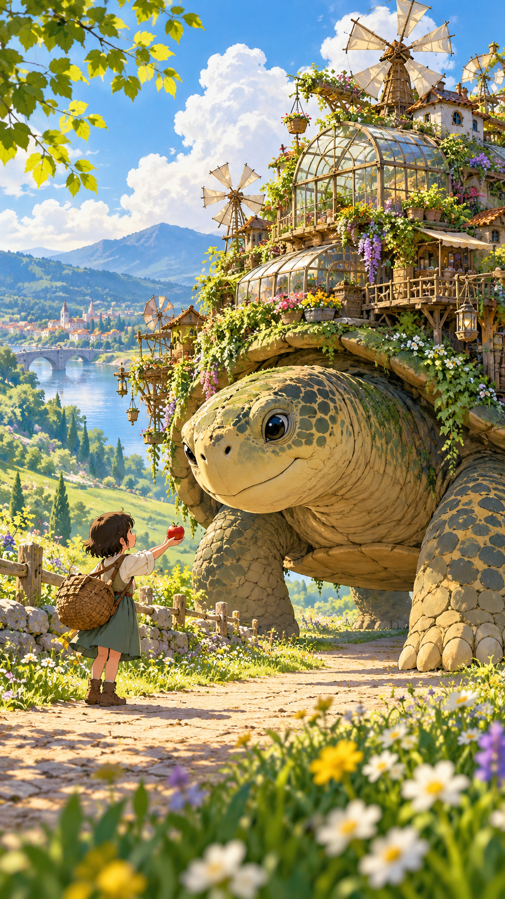

[Watch video 1](videos/ghibli-02.mp4) · [Download MP4 + WebP + PNG](downloads/ghibli-02.zip)

**Video prompt**

```text
Opening frame: A colossal friendly turtle carries a greenhouse village on its shell while a child offers it an apple beside a sunny path.

0.0–1.0 seconds: Small windmills and hanging flowers turn as the turtle slowly leans its head toward the offered apple.
1.0–3.6 seconds: The turtle delicately takes the apple; the child laughs. A few petals fall from the shell village and drift around them.
3.6–5.0 seconds: Camera eases upward to reveal the lush little homes and glasshouses on its back as the turtle resumes walking. Hold the final image clearly for the last 0.3 seconds.

Camera and visual style: Warm hand-painted watercolor fantasy; slow believable creature weight, expressive but subtle faces. Sound, if supported: Soft footsteps, windmill creaks, child laughter, light woodwind melody. Keep the movement brisk but readable, prioritizing one main action and a clear final payoff. Keep character identities and object geometry consistent. One continuous shot, with no cuts, teleporting, face changes, extra limbs, unintended text, or watermarks.
```

### The Storm in a Lantern

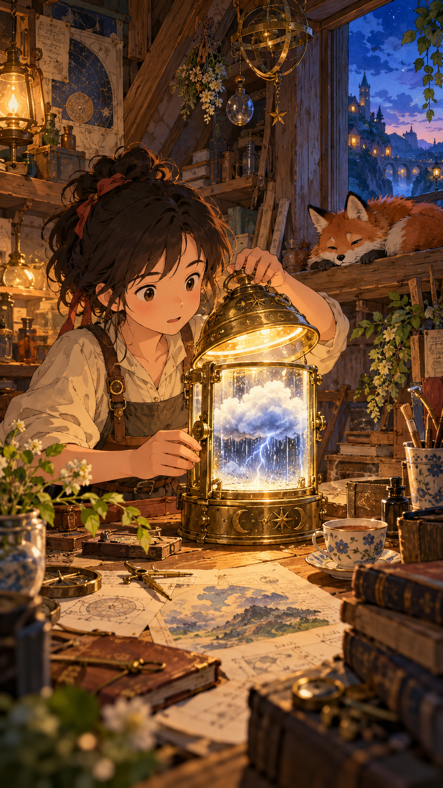

[Watch video 1](videos/ghibli-03.mp4) · [Download MP4 + WebP + PNG](downloads/ghibli-03.zip)

**Video prompt**

```text
Opening frame: A young inventor opens a brass lantern containing a tiny thundercloud; a fox rests on the nearby window sill.

0.0–1.0 seconds: Blue miniature lightning flickers inside the lantern. The inventor lifts the lid slightly; the fox opens one eye.
1.0–3.6 seconds: The cloud floats out, no larger than a teacup, and releases a tiny rain shower onto a single sheet of paper.
3.6–5.0 seconds: The wet paper blooms into a miniature painted landscape. The inventor and fox lean in, amazed, while the cloud glows softly. Hold the final image clearly for the last 0.3 seconds.

Camera and visual style: Delicate hand-painted animation; one close camera drift across the worktable, preserve object placement. Sound, if supported: Tiny thunder pop, paper patter, soft fox rustle, playful celesta. Keep the movement brisk but readable, prioritizing one main action and a clear final payoff. Keep character identities and object geometry consistent. One continuous shot, with no cuts, teleporting, face changes, extra limbs, unintended text, or watermarks.
```

### Sky Whale Crossing

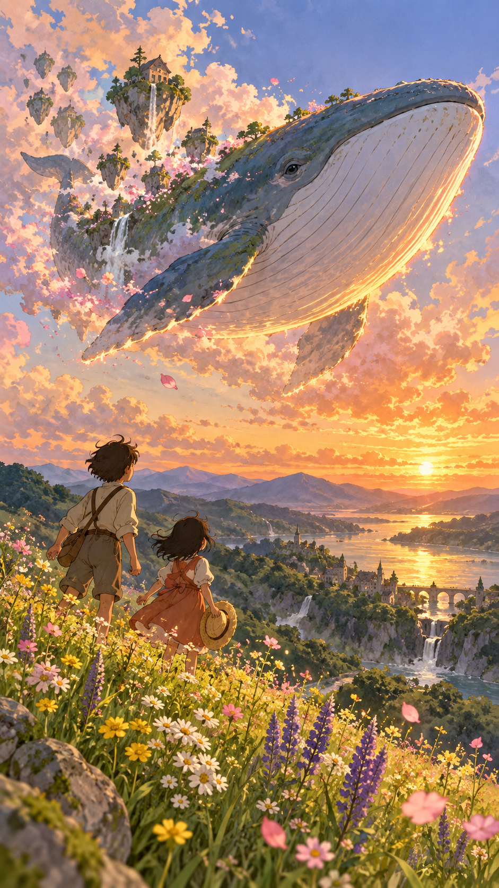

[Watch video 1](videos/ghibli-04.mp4) · [Download MP4 + WebP + PNG](downloads/ghibli-04.zip)

**Video prompt**

```text
Opening frame: Two siblings stand in a flower-filled hillside meadow beneath a huge peaceful sky whale and floating islands at sunset.

0.0–1.0 seconds: The whale glides overhead; flowers bend in its gentle slipstream and petals lift around the children.
1.0–3.6 seconds: Both children run a few steps along the hill, tracking it with their eyes as one floating island passes across the sun.
3.6–5.0 seconds: The whale turns slightly, revealing its full scale against the golden valley; a single petal lands in a child's open hand. Hold the final image clearly for the last 0.3 seconds.

Camera and visual style: Airy hand-painted watercolor fantasy; slow sweeping camera from behind the children, awe rather than speed. Sound, if supported: Wind through grass, distant whale call, expansive warm strings. Keep the movement brisk but readable, prioritizing one main action and a clear final payoff. Keep character identities and object geometry consistent. One continuous shot, with no cuts, teleporting, face changes, extra limbs, unintended text, or watermarks.
```

### The Rainy Bakery

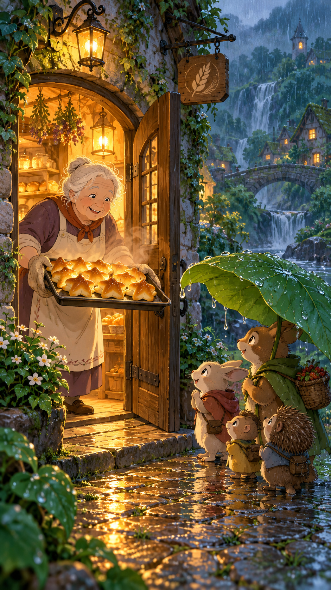

[Watch video 1](videos/ghibli-05.mp4) · [Download MP4 + WebP + PNG](downloads/ghibli-05.zip)

**Video prompt**

```text
Opening frame: An elderly baker offers a tray of star-shaped buns to tiny forest creatures waiting under a large leaf in the rain.

0.0–1.0 seconds: Steam curls from the fresh buns. The smallest creature leans forward eagerly while raindrops roll off the leaf umbrella.
1.0–3.6 seconds: A playful breeze lifts exactly one bun from the tray; it floats across the doorway as the baker and creatures follow it with their eyes.
3.6–5.0 seconds: The smallest creature catches it gently with both paws. Everyone breaks into laughter under the warm bakery light. Hold the final image clearly for the last 0.3 seconds.

Camera and visual style: Cozy hand-painted watercolor animation; steady doorway framing with subtle character movement. Sound, if supported: Rain, oven crackle, tiny surprised squeak, warm acoustic melody. Keep the movement brisk but readable, prioritizing one main action and a clear final payoff. Keep character identities and object geometry consistent. One continuous shot, with no cuts, teleporting, face changes, extra limbs, unintended text, or watermarks.
```

## Football troll

### Premature Celebration


[Watch video 1](videos/football-01.mp4) · [Download MP4 + WebP + PNG](downloads/football-01.zip)

**Video prompt**

```text
Opening frame: An orange-clad striker celebrates in front of the goal while the ball still rolls nearby and a blue defender races toward it.

0.0–1.0 seconds: The striker keeps celebrating, unaware. The camera holds both this person and the open goal in the same frame.
1.0–3.6 seconds: The blue defender reaches the ball at the last possible moment and clears it off the line; the crowd sound abruptly shifts to a collective gasp.
3.6–5.0 seconds: The striker turns, sees the empty goal, and freezes with arms still raised. End on this person's stunned face and the defender's cheeky wave. Hold the final image clearly for the last 0.3 seconds.

Camera and visual style: Photorealistic sports-comedy timing, one readable broadcast-style shot, clear ball trajectory. Sound, if supported: Crowd cheer cuts to gasp, firm ball kick, comic silence. Keep the movement brisk but readable, prioritizing one main action and a clear final payoff. Keep character identities and object geometry consistent. One continuous shot, with no cuts, teleporting, face changes, extra limbs, unintended text, or watermarks.
```

### Accidental Wonder Goal


[Watch video 1](videos/football-02.mp4) · [Download MP4 + WebP + PNG](downloads/football-02.zip)

**Video prompt**

```text
Opening frame: A green-clad striker plants for a trick shot on a rain-soaked pitch while a yellow goalkeeper waits in the goal.

0.0–1.0 seconds: This person's planted boot loses grip in a puddle. Keep the ball, boot, and goal visible as the slip starts.
1.0–3.6 seconds: This person tumbles harmlessly backward, but this person's swinging foot accidentally chips the ball in a perfect high arc over the surprised keeper.
3.6–5.0 seconds: The ball drops into the net as the striker sits in a puddle staring in disbelief; the goalkeeper turns slowly to look behind this person. Hold the final image clearly for the last 0.3 seconds.

Camera and visual style: Photorealistic sports comedy; coherent foot-to-ball contact and ball physics, no injury. Sound, if supported: Wet skid, accidental kick, net rustle, crowd eruption and comic brass sting. Keep the movement brisk but readable, prioritizing one main action and a clear final payoff. Keep character identities and object geometry consistent. One continuous shot, with no cuts, teleporting, face changes, extra limbs, unintended text, or watermarks.
```

### The Heroic Miss


[Watch video 1](videos/football-03.mp4) · [Download MP4 + WebP + PNG](downloads/football-03.zip)

**Video prompt**

```text
Opening frame: A violet goalkeeper is mid-air in a dramatic dive while a white-clad striker watches a floating shot near the goal.

0.0–1.0 seconds: The camera follows the ball's gentle flight while the keeper stretches with exaggerated determination.
1.0–3.6 seconds: The ball passes just outside the near post and brushes only the outside of the net. The goalkeeper lands in a theatrical roll.
3.6–5.0 seconds: The keeper springs up to celebrate a 'save,' then realizes the ball missed anyway. This person and the striker exchange one awkward stare. Hold the final image clearly for the last 0.3 seconds.

Camera and visual style: Photorealistic stadium comedy; maintain a precise, consistent ball path and continuous shot. Sound, if supported: Crowd holds breath, soft outside-net brush, awkward quiet, scattered laughter. Keep the movement brisk but readable, prioritizing one main action and a clear final payoff. Keep character identities and object geometry consistent. One continuous shot, with no cuts, teleporting, face changes, extra limbs, unintended text, or watermarks.
```

### Mascot Nutmeg

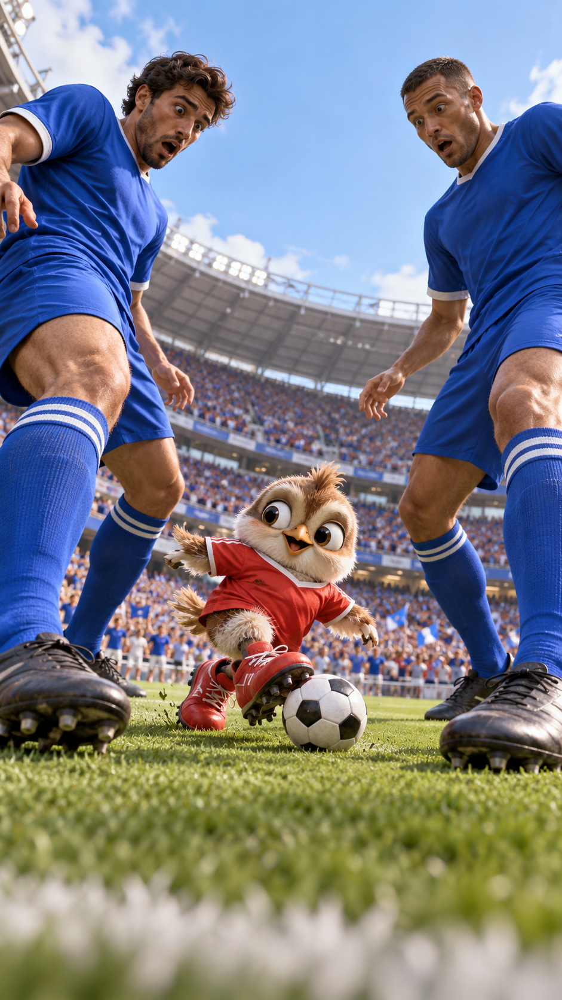

[Watch video 1](videos/football-04.mp4) · [Download MP4 + WebP + PNG](downloads/football-04.zip)

**Video prompt**

```text
Opening frame: A tiny fluffy bird mascot in a red jersey controls a ball between two tall blue-clad players who look down in shock.

0.0–1.0 seconds: The mascot taps the ball left-right with its oversized boots; both defenders lean the wrong way.
1.0–3.6 seconds: It pokes the ball cleanly through the gap between the two players' legs and darts after it.
3.6–5.0 seconds: The defenders turn too late and gently bump shoulders. The mascot spins back with a cheeky bow as the crowd erupts. Hold the final image clearly for the last 0.3 seconds.

Camera and visual style: Playful photorealistic stadium comedy; keep the mascot's size and costume consistent and the ball visible. Sound, if supported: Quick boot taps, squeak, soft shoulder bump, roaring laughter. Keep the movement brisk but readable, prioritizing one main action and a clear final payoff. Keep character identities and object geometry consistent. One continuous shot, with no cuts, teleporting, face changes, extra limbs, unintended text, or watermarks.
```

### Sprinkler Celebration


[Watch video 1](videos/football-05.mp4) · [Download MP4 + WebP + PNG](downloads/football-05.zip)

**Video prompt**

```text
Opening frame: A purple-clad player is already knee-sliding toward active sprinklers while teammates cheer behind this person.

0.0–1.0 seconds: This person's slide continues directly into the rising spray; hold the wide stadium view so the collision is readable.
1.0–3.6 seconds: A sprinkler swivels and blasts this person's face. This person blinks, sputters harmlessly, and tries to keep this person's victory pose.
3.6–5.0 seconds: Two teammates run into the same spray and stop laughing to cover their faces. End with all three laughing in the rain-like mist. Hold the final image clearly for the last 0.3 seconds.

Camera and visual style: Photorealistic football comedy, natural water movement, one low tracking shot, no falls or injuries. Sound, if supported: Stadium cheer, sudden water hiss, surprised sputter, teammate laughter. Keep the movement brisk but readable, prioritizing one main action and a clear final payoff. Keep character identities and object geometry consistent. One continuous shot, with no cuts, teleporting, face changes, extra limbs, unintended text, or watermarks.
```

## 80s–90s nostalgia

### Midnight Arcade


[Watch video 1](videos/nostalgia-01.mp4) · [Download MP4 + WebP + PNG](downloads/nostalgia-01.zip)

**Video prompt**

```text
Opening frame: This person in a faded denim jacket stands at a neon arcade cabinet with this person's hand over the joystick; a late-1980s arcade glows behind this person.

0.0–1.0 seconds: This person presses the start button. The cabinet lights pulse on and the joystick click makes this person pause as if this person recognizes a familiar tune.
1.0–3.6 seconds: This person plays with quick, precise movements. The screen's pixel colors reflect across this person's face and ripple over the polished floor while the camera slides slowly from this person's hand to this person's expression.
3.6–5.0 seconds: The game reaches a bright visual climax inside the screen; this person breaks into a surprised, playful grin. Hold that expression in the neon light for the final half-second. Hold the final image clearly for the last 0.3 seconds.

Camera and visual style: Photorealistic 1980s atmosphere, subtle film grain, one smooth sideways camera slide; effects remain inside the cabinet and reflections. Sound, if supported: Original chiptune motif, button taps, arcade ambience, gentle nostalgic synth swell. Keep the movement brisk but readable, prioritizing one main action and a clear final payoff. Keep character identities and object geometry consistent. One continuous shot, with no cuts, teleporting, face changes, extra limbs, unintended text, or watermarks.
```

### The Mixtape Drive

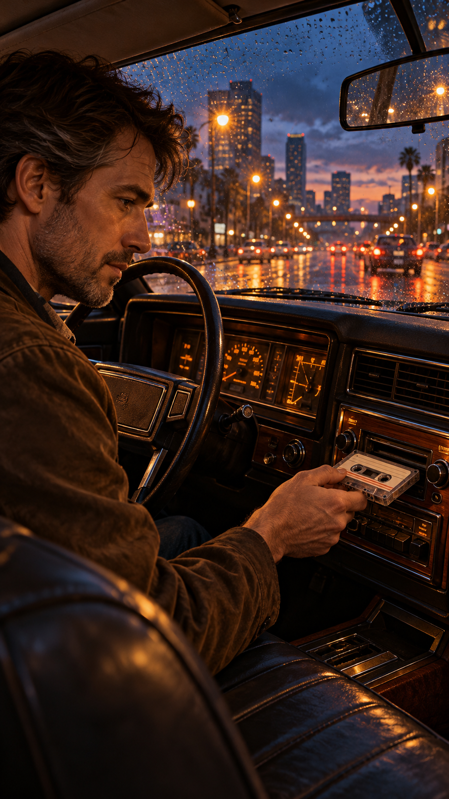

[Watch video 1](videos/nostalgia-02.mp4) · [Download MP4 + WebP + PNG](downloads/nostalgia-02.zip)

**Video prompt**

```text
Opening frame: This person in an old sedan holds a cassette at the dashboard player while rain beads on the windshield and city lights glow at dusk.

0.0–1.0 seconds: This person slides the cassette into the player. The mechanism clicks, the reels start, and this person turns this person's eyes toward the road ahead.
1.0–3.6 seconds: The first beat of an original 1980s-inspired song arrives. The camera glides from spinning cassette to this person's profile; wipers clear a lane through the rain, revealing a ribbon of amber streetlights.
3.6–5.0 seconds: This person smiles faintly and drives into the glowing boulevard. Reflections stream across the windshield as the camera stays inside the car and holds the mood. Hold the final image clearly for the last 0.3 seconds.

Camera and visual style: Intimate photorealistic 1980s road-film look, warm dashboard versus blue dusk, one continuous interior shot. Sound, if supported: Cassette click, soft tape hiss, wipers, original nostalgic synth groove. Keep the movement brisk but readable, prioritizing one main action and a clear final payoff. Keep character identities and object geometry consistent. One continuous shot, with no cuts, teleporting, face changes, extra limbs, unintended text, or watermarks.
```

### The Last Video Store

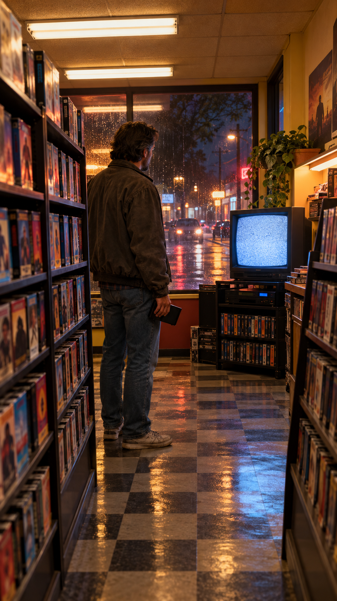

[Watch video 1](videos/nostalgia-03.mp4) · [Download MP4 + WebP + PNG](downloads/nostalgia-03.zip)

**Video prompt**

```text
Opening frame: This person holding an unmarked VHS tape stands in a 1990s rental store while a CRT television shows blue static and rain glows outside.

0.0–1.0 seconds: The TV static grows brighter; this person slowly turns from the window toward its familiar crackle.
1.0–3.6 seconds: The static clears into a soft, silent home-video-like image of a sunny childhood street, visible only within the TV. This person takes one step closer, VHS tape still in hand.
3.6–5.0 seconds: The screen light warms this person's face; this person gives a quiet smile as the shot moves in close. Let the store and rain remain visible around this person. Hold the final image clearly for the last 0.3 seconds.

Camera and visual style: One steady dolly through the aisle, analog texture and gentle CRT flicker; no legible titles or new people in the store. Sound, if supported: TV hiss fades into distant children playing and a restrained nostalgic piano theme. Keep the movement brisk but readable, prioritizing one main action and a clear final payoff. Keep character identities and object geometry consistent. One continuous shot, with no cuts, teleporting, face changes, extra limbs, unintended text, or watermarks.
```

### One More Street Match

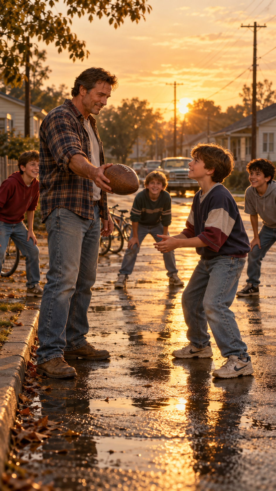

[Watch video 1](videos/nostalgia-04.mp4) · [Download MP4 + WebP + PNG](downloads/nostalgia-04.zip)

**Video prompt**

```text
Opening frame: This person, in their forties, holds an old brown American football toward that person while several children wait on a sunlit 1990s neighborhood street.

0.0–1.0 seconds: This person tosses the ball gently to that person. The other children run into open space, shoes splashing through shallow puddles.
1.0–3.6 seconds: That person catches and throws it back in a high arc. The camera tracks the ball against the amber sky, then follows this person's hands as this person catches it cleanly.
3.6–5.0 seconds: For a brief beat, this person and that person grin at each other. The group runs down the street together into the sunset, leaving the ball and their faces clearly visible. Hold the final image clearly for the last 0.3 seconds.

Camera and visual style: Warm photorealistic 1990s memory, soft film grain, continuous flowing camera; preserve the same people and street. Sound, if supported: Ball catch, children's laughter, sneakers on wet pavement, gentle original guitar melody. Keep the movement brisk but readable, prioritizing one main action and a clear final payoff. Keep character identities and object geometry consistent. One continuous shot, with no cuts, teleporting, face changes, extra limbs, unintended text, or watermarks.
```

### Dial-up Universe

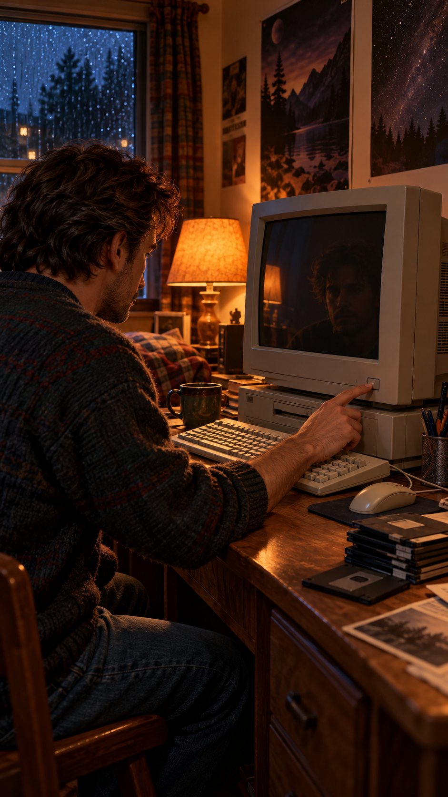

[Watch video 1](videos/nostalgia-05.mp4) · [Download MP4 + WebP + PNG](downloads/nostalgia-05.zip)

**Video prompt**

```text
Opening frame: This person sits in a cozy 1990s bedroom before a dark beige CRT monitor, fingertip on the power button, with floppy disks on the desk.

0.0–1.0 seconds: This person presses the button; the machine hums awake and a small square of light grows at the center of the glass.
1.0–3.6 seconds: An original star-field screensaver appears and expands across the CRT. Its cool light plays over the keyboard, desk, and this person's face while the camera pushes closer from over this person's shoulder.
3.6–5.0 seconds: This person leans toward the screen, smiling as pixel stars drift in this person's reflection. End with the glowing monitor and this person's reflection in the same frame. Hold the final image clearly for the last 0.3 seconds.

Camera and visual style: Grounded photorealism with a restrained magical mood; keep all effects as light and imagery from the monitor. Sound, if supported: Power switch, computer fan, modem-like chirps, gentle ambient synth. Keep the movement brisk but readable, prioritizing one main action and a clear final payoff. Keep character identities and object geometry consistent. One continuous shot, with no cuts, teleporting, face changes, extra limbs, unintended text, or watermarks.
```

## Martial arts

### Dawn Form

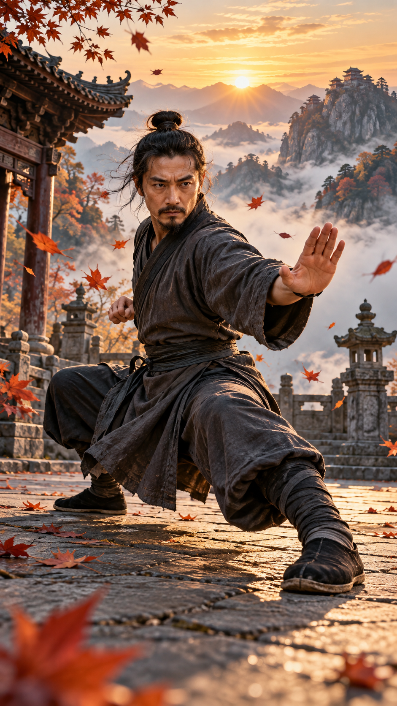

[Watch video 1](videos/martial-01.mp4) · [Download MP4 + WebP + PNG](downloads/martial-01.zip)

**Video prompt**

```text
Opening frame: A martial artist in charcoal robes holds a low stance in a mountain temple courtyard as autumn leaves drift through sunrise mist.

0.0–1.0 seconds: This person draws one slow breath, shifts weight through this person's legs, and rotates this person's extended palm with controlled precision.
1.0–3.6 seconds: This person performs a fast three-movement empty-hand form: a low sweeping turn, a rising block, then a sharp forward palm thrust. Leaves swirl naturally in the wake of this person's movement.
3.6–5.0 seconds: This person stops completely in a balanced stance as one leaf settles onto this person's open hand. Hold the stillness against the glowing mountains. Hold the final image clearly for the last 0.3 seconds.

Camera and visual style: Grounded cinematic martial-arts choreography, accurate foot placement and cloth physics, one low circular tracking shot. Sound, if supported: Wind, cloth swish, foot scuff on stone, deep single drum hit at the final stance. Keep the movement brisk but readable, prioritizing one main action and a clear final payoff. Keep character identities and object geometry consistent. One continuous shot, with no cuts, teleporting, face changes, extra limbs, unintended text, or watermarks.
```

### The Final Board

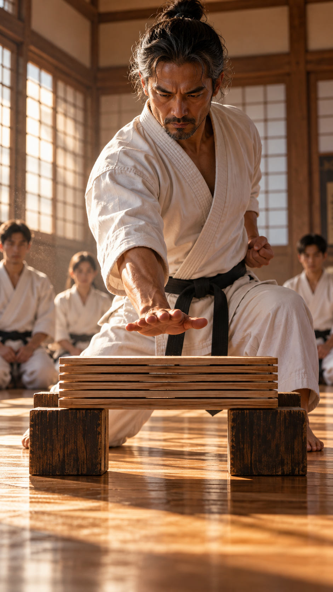

[Watch video 1](videos/martial-02.mp4) · [Download MP4 + WebP + PNG](downloads/martial-02.zip)

**Video prompt**

```text
Opening frame: A practitioner in a white gi holds this person's open hand just above a stack of thin boards in a sunlit dojo as students watch behind this person.

0.0–1.0 seconds: This person steadies this person's breathing, lowers this person's center of gravity, and fixes this person's eyes on the center board.
1.0–3.6 seconds: This person delivers one crisp downward open-hand strike. The boards split cleanly in a brief slow-motion moment, with small wooden splinters and dust moving naturally.
3.6–5.0 seconds: This person withdraws this person's hand without flourish; the students react with quiet astonishment. End on this person's calm face and the separated boards. Hold the final image clearly for the last 0.3 seconds.

Camera and visual style: Photorealistic traditional dojo, one controlled side push-in, physically plausible movement and break. Sound, if supported: Silence before strike, sharp wood crack, falling pieces, soft collective gasp. Keep the movement brisk but readable, prioritizing one main action and a clear final payoff. Keep character identities and object geometry consistent. One continuous shot, with no cuts, teleporting, face changes, extra limbs, unintended text, or watermarks.
```

### Rooftop Spar

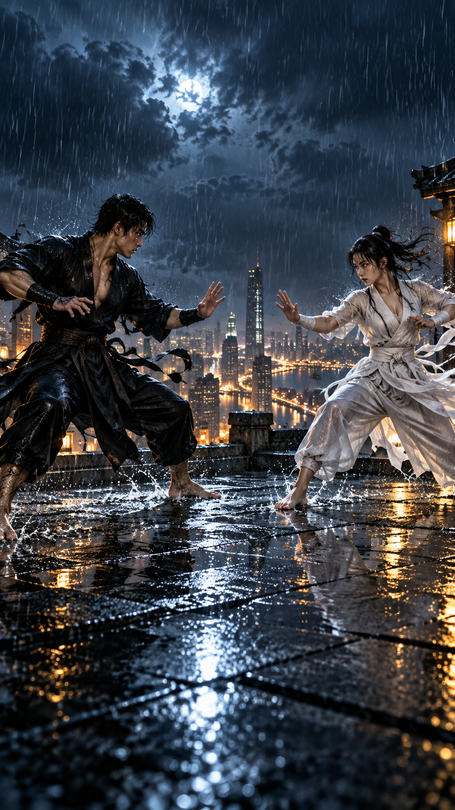

[Watch video 1](videos/martial-03.mp4) · [Download MP4 + WebP + PNG](downloads/martial-03.zip)

**Video prompt**

```text
Opening frame: Two martial artists, one in black and one in white, face each other barefoot on a rain-soaked rooftop above city lights.

0.0–1.0 seconds: They circle one step through puddles, eyes locked, exchanging a respectful nod.
1.0–3.6 seconds: The fighter in black advances with two fast open-hand techniques; the fighter in white parries, pivots, and redirects the momentum into a clean non-contact sweep. Water sprays from each planted foot.
3.6–5.0 seconds: Both recover into balanced stances a few feet apart and exchange a small smile. Hold the tension as rain streaks between them. Hold the final image clearly for the last 0.3 seconds.

Camera and visual style: One continuous mid-wide tracking shot; readable choreography, no injuries or impossible body motion. Sound, if supported: Heavy rain, quick foot splashes, cloth snaps, two percussion strikes and a final quiet beat. Keep the movement brisk but readable, prioritizing one main action and a clear final payoff. Keep character identities and object geometry consistent. One continuous shot, with no cuts, teleporting, face changes, extra limbs, unintended text, or watermarks.
```

### Circle of Rhythm


[Watch video 1](videos/martial-04.mp4) · [Download MP4 + WebP + PNG](downloads/martial-04.zip)

**Video prompt**

```text
Opening frame: A capoeira performer already balances on one hand with a leg extended in a coastal town circle at sunset while musicians and dancers watch.

0.0–1.0 seconds: This person continues the existing movement into a controlled spinning kick, keeping clear space from everyone around this person.
1.0–3.6 seconds: The rotation flows into a hand-supported cartwheel and a low sweeping turn. The camera circles in the opposite direction, showing the clapping crowd and golden sea beyond.
3.6–5.0 seconds: This person lands smoothly in a playful low stance facing this person's partner; the circle erupts in applause and this person grins. Hold this person's final pose. Hold the final image clearly for the last 0.3 seconds.

Camera and visual style: Photorealistic joyful capoeira, continuous close-to-wide camera orbit, accurate body balance and footwork. Sound, if supported: Hand claps, berimbau and drum rhythm, foot scrape, delighted cheers. Keep the movement brisk but readable, prioritizing one main action and a clear final payoff. Keep character identities and object geometry consistent. One continuous shot, with no cuts, teleporting, face changes, extra limbs, unintended text, or watermarks.
```

### The Falling Leaf

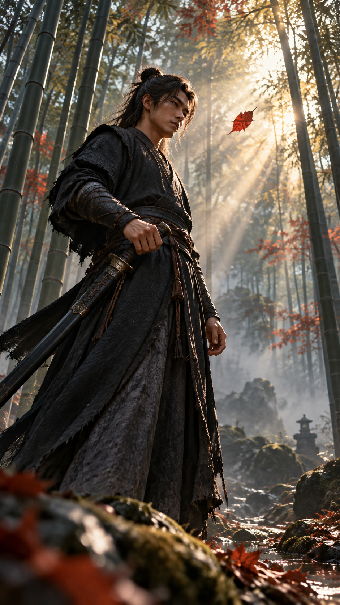

[Watch video 1](videos/martial-05.mp4) · [Download MP4 + WebP + PNG](downloads/martial-05.zip)

**Video prompt**

```text
Opening frame: This dark-robed person stands beside a floating red leaf in a misty bamboo grove, hand on the hilt of this person's sheathed sword.

0.0–1.0 seconds: The leaf drifts down across this person's eye line. This person inhales and subtly shifts this person's lead foot, keeping the blade sheathed.
1.0–3.6 seconds: In one precise motion this person draws, makes a single clean diagonal cut through the falling leaf, and stops; show the two leaf halves drifting apart in brief slow motion.
3.6–5.0 seconds: This person smoothly re-sheathes the sword while the leaf halves touch the ground. End on this person's composed profile against sunlit bamboo. Hold the final image clearly for the last 0.3 seconds.

Camera and visual style: Elegant cinematic sword practice, restrained movement, coherent blade path, one gentle camera push. Sound, if supported: Bamboo wind, crisp blade ring, light leaf rustle, sparse flute note. Keep the movement brisk but readable, prioritizing one main action and a clear final payoff. Keep character identities and object geometry consistent. One continuous shot, with no cuts, teleporting, face changes, extra limbs, unintended text, or watermarks.
```

## Adventure

### The Hidden Temple

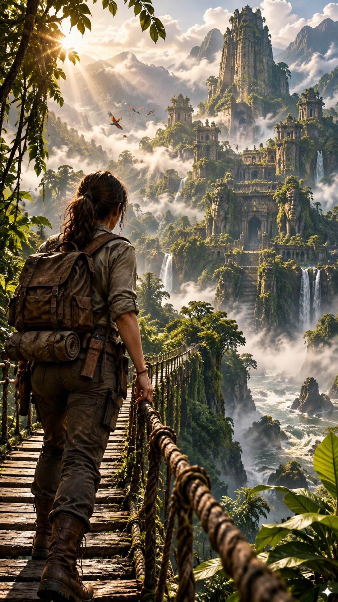

[Watch video 1](videos/adventure-01.mp4) · [Download MP4 + WebP + PNG](downloads/adventure-01.zip)

**Video prompt**

```text
Opening frame: An explorer is already on a narrow rope bridge above a jungle gorge, facing a huge moss-covered temple in morning mist.

0.0–1.0 seconds: The bridge sways under a careful step. The explorer grips the rope and looks up as birds lift from the temple canopy.
1.0–3.6 seconds: The camera moves forward over the explorer's shoulder as they advance several planks; sunlight breaks through the mist, gradually revealing carved faces, waterfalls, and the full temple façade.
3.6–5.0 seconds: A shaft of light reaches the dark entrance. The explorer stops in awe as the camera rises just enough to show the scale of the discovery. Hold the final image clearly for the last 0.3 seconds.

Camera and visual style: Continuous over-the-shoulder crane, photorealistic jungle depth, natural bridge sway and mist. Sound, if supported: Rope creak, rushing river, distant birds, expanding orchestral wonder. Keep the movement brisk but readable, prioritizing one main action and a clear final payoff. Keep character identities and object geometry consistent. One continuous shot, with no cuts, teleporting, face changes, extra limbs, unintended text, or watermarks.
```

### City Beneath the Dunes

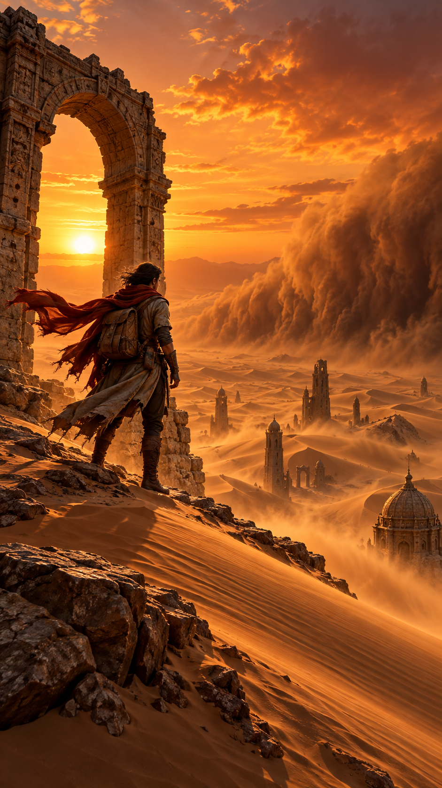

[Watch video 1](videos/adventure-02.mp4) · [Download MP4 + WebP + PNG](downloads/adventure-02.zip)

**Video prompt**

```text
Opening frame: An explorer in a windblown scarf stands by an ancient stone arch overlooking visible towers in the desert as a sandstorm approaches.

0.0–1.0 seconds: The explorer braces against rising wind; sand streams past the arch and partially veils the scattered towers.
1.0–3.6 seconds: The storm front rolls across the valley. Wind peels loose sand from rooftops and streets, revealing more of the buried city's grand geometry while the camera rises behind the explorer.
3.6–5.0 seconds: As the storm passes to one side, golden sunlight illuminates a central domed plaza. The explorer lowers their arm, stunned by the full city. Hold the final image clearly for the last 0.3 seconds.

Camera and visual style: Epic photorealistic desert scale, one continuous rising reveal; preserve the towers already present in the first frame. Sound, if supported: Wind crescendo, sand hiss, deep music swell, brief silence at the reveal. Keep the movement brisk but readable, prioritizing one main action and a clear final payoff. Keep character identities and object geometry consistent. One continuous shot, with no cuts, teleporting, face changes, extra limbs, unintended text, or watermarks.
```

### Above the Clouds

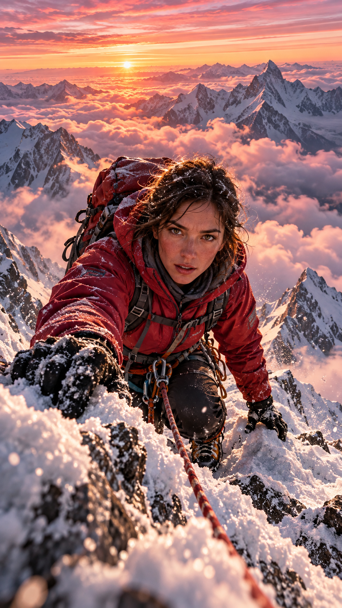

[Watch video 1](videos/adventure-03.mp4) · [Download MP4 + WebP + PNG](downloads/adventure-03.zip)

**Video prompt**

```text
Opening frame: A climber in a red parka grips a snowy summit ridge at sunrise with a rope visible and peaks above the cloud sea.

0.0–1.0 seconds: This person plants a boot securely, checks this person's grip, and pulls this person's weight upward over the final icy lip.
1.0–3.6 seconds: With one controlled effort this person climbs onto the summit, stands, and turns toward the vast horizon. The camera follows from close beside this person to a wider view.
3.6–5.0 seconds: Pink light washes the peaks as this person raises one arm in a quiet victory gesture. Hold the immense cloudscape and this person's silhouette. Hold the final image clearly for the last 0.3 seconds.

Camera and visual style: Physically grounded mountaineering motion, continuous camera pullback, realistic wind and ice crystals. Sound, if supported: Breathing, crampon crunch, rope tension, wide orchestral rise. Keep the movement brisk but readable, prioritizing one main action and a clear final payoff. Keep character identities and object geometry consistent. One continuous shot, with no cuts, teleporting, face changes, extra limbs, unintended text, or watermarks.
```

### The Sunken Giant


[Watch video 1](videos/adventure-04.mp4) · [Download MP4 + WebP + PNG](downloads/adventure-04.zip)

**Video prompt**

```text
Opening frame: A diver hovers to the left of a coral-covered shipwreck while a giant manta silhouette is already visible through a sunlit opening.

0.0–1.0 seconds: The diver's lamp sweeps across ancient wood and coral. Tiny fish part as the silhouette begins moving closer.
1.0–3.6 seconds: The manta glides through the opening into shafts of sunlight and passes slowly over the wreck. The diver turns to follow it, bubbles rising toward the surface.
3.6–5.0 seconds: The camera drifts behind the diver as the manta fills the open blue water for one majestic moment, then recedes into light. Hold the final image clearly for the last 0.3 seconds.

Camera and visual style: Serene photorealistic underwater motion, accurate buoyancy and slow camera drift; one unbroken shot. Sound, if supported: Muffled underwater ambience, breath regulator, soft bubbles, spacious ambient score. Keep the movement brisk but readable, prioritizing one main action and a clear final payoff. Keep character identities and object geometry consistent. One continuous shot, with no cuts, teleporting, face changes, extra limbs, unintended text, or watermarks.
```

### The Storm Passage

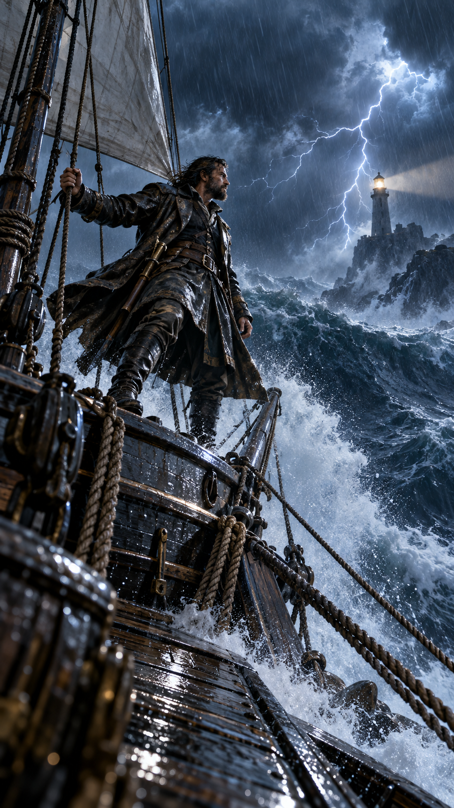

[Watch video 1](videos/adventure-05.mp4) · [Download MP4 + WebP + PNG](downloads/adventure-05.zip)

**Video prompt**

```text
Opening frame: A sea captain grips the rigging near the prow of a wooden ship in rain, with a dark wave and distant lighthouse ahead.

0.0–1.0 seconds: The ship pitches upward; the captain tightens this person's grip, spray striking this person's coat while lightning outlines the lighthouse.
1.0–3.6 seconds: The bow climbs the steep wave. The camera tracks low along the deck as ropes pull taut and water races away from the lens.
3.6–5.0 seconds: The ship crests and drops into a brief calm trough. The lighthouse beam sweeps across the captain's face; this person points the crew toward it as the horizon opens. Hold the final image clearly for the last 0.3 seconds.

Camera and visual style: Epic but believable maritime realism, continuous deck-level shot, coherent ship and water physics. Sound, if supported: Wind, rigging strain, wave crash, thunder, resolute orchestral swell. Keep the movement brisk but readable, prioritizing one main action and a clear final payoff. Keep character identities and object geometry consistent. One continuous shot, with no cuts, teleporting, face changes, extra limbs, unintended text, or watermarks.
```

## Bonus demo

### Rooftop Leap

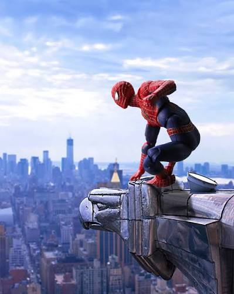

[Watch video 1](videos/rooftop-hero.mp4) · [Download MP4 + WebP + PNG](downloads/rooftop-hero.zip)

**Video prompt**

```text
Opening frame: A masked hero in a red-and-blue suit crouches on a stone gargoyle high over the city beneath a wide, bright sky.

0.0–1.0 seconds: The hero lifts this person's head toward the horizon. A gust moves across the rooftop and the camera eases closer from behind this person's shoulder.
1.0–3.6 seconds: This person pushes off the gargoyle in a powerful leap, dives through open air, then sends a thin line toward a building outside the frame. The camera follows this person over the city in one fluid descent.
3.6–5.0 seconds: The line pulls taut and this person swings in a graceful arc past the camera. Sunlight flares around this person's silhouette as the city opens beneath this person; end on a clean, soaring wide shot. Hold the final image clearly for the last 0.3 seconds.

Camera and visual style: Photorealistic superhero action, natural daylight, believable gravity, stable costume detail, one continuous sweeping camera move. Sound, if supported: Wind rush, leap impact, taut-line snap, rising cinematic score. Keep the movement brisk but readable, prioritizing one main action and a clear final payoff. Keep character identities and object geometry consistent. One continuous shot, with no cuts, teleporting, face changes, extra limbs, unintended text, or watermarks.
```

### Skyline Courier — Alternate

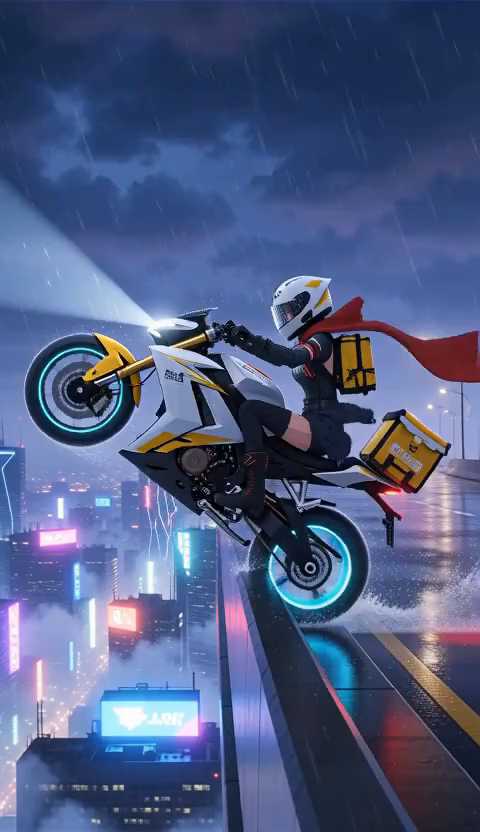

[Watch video 1](videos/anime-02-alt.mp4) · [Download MP4 + WebP + PNG](downloads/anime-02-alt.zip)

**Video prompt**

```text
Opening frame: An anime courier in a white helmet, black suit, and long red scarf lifts a white-and-yellow motorcycle onto a narrow rooftop rail above a rainy neon city.

0.0–1.0 seconds: The front wheel rises and spins, its cyan rim reflecting in the rain. The courier leans forward as the red scarf whips across the frame.
1.0–3.6 seconds: The bike accelerates along the slick rail and launches out over the city. The camera tracks beside the courier in one sweeping move as the headlights cut through the mist.
3.6–5.0 seconds: The courier clears a rooftop gap and lands smoothly on the next elevated path. Water sprays behind the glowing wheels; hold the triumphant citywide silhouette at the end. Hold the final image clearly for the last 0.3 seconds.

Camera and visual style: High-end anime action, strong perspective, expressive rain and neon reflections, one continuous side-tracking shot with controlled motion blur. Sound, if supported: Electric motor whine, rain, tire spray, rising original electronic score. Keep the movement brisk but readable, prioritizing one main action and a clear final payoff. Keep character identities and object geometry consistent. One continuous shot, with no cuts, teleporting, face changes, extra limbs, unintended text, or watermarks.
```

### An Unexpected Face on the CRT

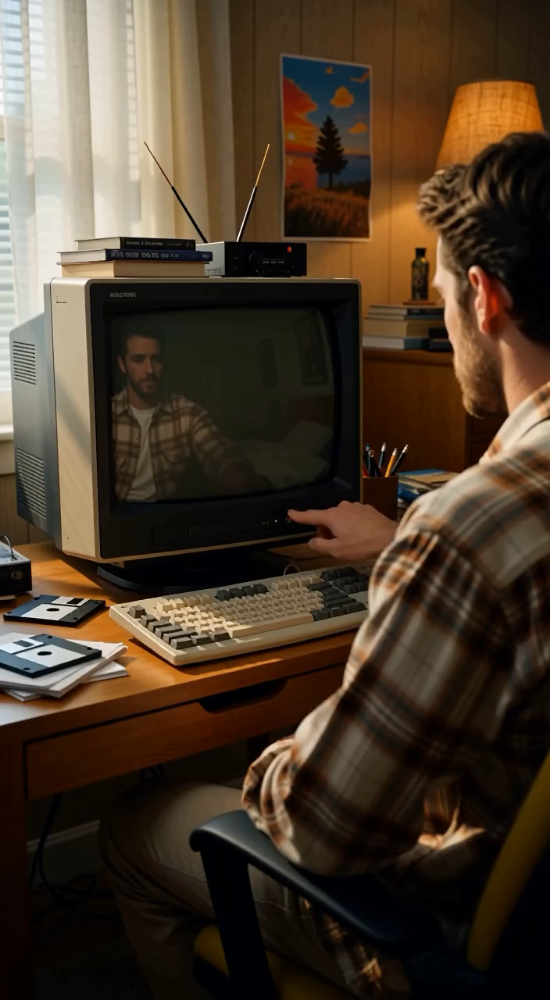

[Watch video 1](videos/nostalgia-alt.mp4) · [Download MP4 + WebP + PNG](downloads/nostalgia-alt.zip)

**Video prompt**

```text
Opening frame: This person in a 1990s bedroom sits at a bulky CRT computer; the dark screen reflects this person's face while a warm lamp and floppy disks surround this person.

0.0–1.0 seconds: This person's finger taps the power button and the CRT flickers to life. This person leans closer as faint scan lines sweep across the glass.
1.0–3.6 seconds: A younger version of this person appears in the screen reflection and raises a hand a fraction before this person does. The camera pushes gently over this person's shoulder while the room remains still.
3.6–5.0 seconds: This person places this person's palm against the glass; the reflected palm meets it. The screen glows softly, and this person's surprised expression settles into a quiet smile. Hold the final image clearly for the last 0.3 seconds.

Camera and visual style: Intimate photorealistic 1990s nostalgia, one continuous over-the-shoulder push-in, warm tungsten light and restrained CRT glow. Sound, if supported: Power-button click, soft CRT hum, faint tape hiss, gentle original synth chord. Keep the movement brisk but readable, prioritizing one main action and a clear final payoff. Keep character identities and object geometry consistent. One continuous shot, with no cuts, teleporting, face changes, extra limbs, unintended text, or watermarks.
```

### Circle of Rhythm — Ground Spin

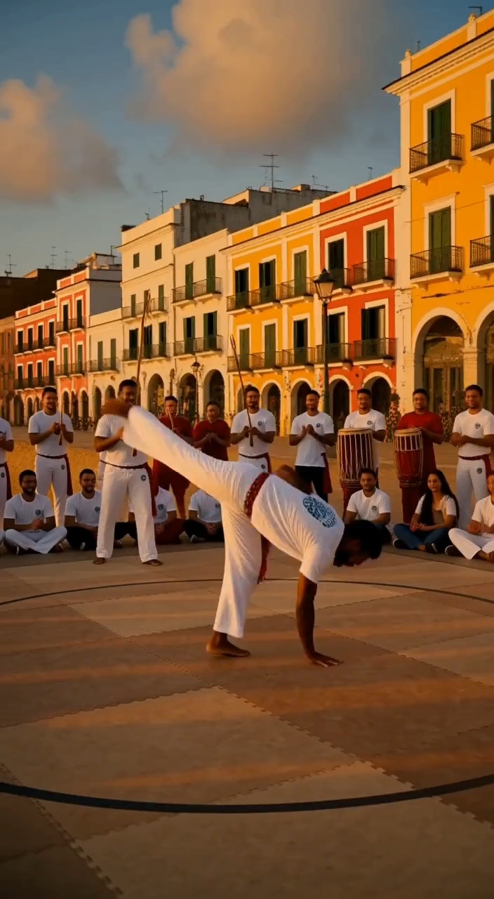

[Watch video 1](videos/martial-04-alt-a.mp4) · [Download MP4 + WebP + PNG](downloads/martial-04-alt-a.zip)

**Video prompt**

```text
Opening frame: At golden hour in a colorful colonial plaza, a capoeira performer in white balances on one palm with one leg extended while musicians and friends clap around the circle.

0.0–1.0 seconds: This person's planted palm grips the ground and the extended leg sweeps forward in time with the clapping rhythm.
1.0–3.6 seconds: This person flows into a fast, controlled ground spin, this person's white clothes and red cord tracing a clean arc while the camera circles with this person at low height.
3.6–5.0 seconds: This person lands lightly, faces the musicians and lifts one hand to the beat as the whole circle cheers; hold the joyful wide composition. Hold the final image clearly for the last 0.3 seconds.

Camera and visual style: Photorealistic capoeira at sunset, one continuous low orbit, warm architectural color, physically believable balance and motion. Sound, if supported: Live berimbau and drum rhythm, handclaps, foot contact, crowd cheer. Keep the movement brisk but readable, prioritizing one main action and a clear final payoff. Keep character identities and object geometry consistent. One continuous shot, with no cuts, teleporting, face changes, extra limbs, unintended text, or watermarks.
```

### Circle of Rhythm — One-Hand Flight

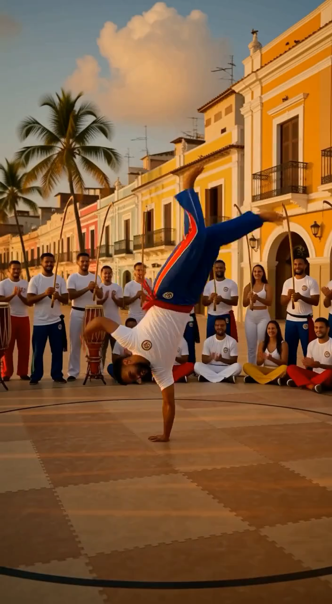

[Watch video 1](videos/martial-04-alt-b.mp4) · [Download MP4 + WebP + PNG](downloads/martial-04-alt-b.zip)

**Video prompt**

```text
Opening frame: In a sunlit colonial plaza, a capoeira performer in blue-and-white training clothes holds a one-hand handstand, legs split high above a circle of clapping musicians.

0.0–1.0 seconds: The performer steadies the one-hand balance for a beat while the red waist cord and loose fabric flutter.
1.0–3.6 seconds: This person rotates through the air in a fluid capoeira spin as the camera sweeps around this person, keeping the plaza and musicians in view.
3.6–5.0 seconds: This person touches down with perfect control and breaks into a quick grin while the drums strike a final flourish; hold the reaction. Hold the final image clearly for the last 0.3 seconds.

Camera and visual style: Photorealistic golden-hour capoeira, continuous camera orbit, energetic but anatomically consistent motion, warm festive colors. Sound, if supported: Berimbau, hand drums, synchronized claps, brief celebratory shout. Keep the movement brisk but readable, prioritizing one main action and a clear final payoff. Keep character identities and object geometry consistent. One continuous shot, with no cuts, teleporting, face changes, extra limbs, unintended text, or watermarks.
```

## Sexy

### Sexy Clip 01


[Watch video](videos/sexy/070064ddf5af47d4d0aa913259b5d070.mp4) · [Download MP4 + WebP + PNG](downloads/sexy/070064ddf5af47d4d0aa913259b5d070.zip)

### Sexy Clip 02


[Watch video](videos/sexy/45fceb0fac3423b232bdea6e7eb165aa.mp4) · [Download MP4 + WebP + PNG](downloads/sexy/45fceb0fac3423b232bdea6e7eb165aa.zip)

### Sexy Clip 03


[Watch video](videos/sexy/468c4f3825ac5c1d2accc1bda70ab5f1.mp4) · [Download MP4 + WebP + PNG](downloads/sexy/468c4f3825ac5c1d2accc1bda70ab5f1.zip)

### Sexy Clip 04


[Watch video](videos/sexy/7b212362b182f1fc9d97fb8d95fc72f7.mp4) · [Download MP4 + WebP + PNG](downloads/sexy/7b212362b182f1fc9d97fb8d95fc72f7.zip)

### Sexy Clip 05


[Watch video](videos/sexy/8a25c98ae70fbd02e87720b641665c3f.mp4) · [Download MP4 + WebP + PNG](downloads/sexy/8a25c98ae70fbd02e87720b641665c3f.zip)

### Sexy Clip 06


[Watch video](videos/sexy/907d1f3e4f4fba51fb7e52747bfdf33a.mp4) · [Download MP4 + WebP + PNG](downloads/sexy/907d1f3e4f4fba51fb7e52747bfdf33a.zip)

### Sexy Clip 07


[Watch video](videos/sexy/c786617e2a3fdfbb8be6c6fc7e86cee4.mp4) · [Download MP4 + WebP + PNG](downloads/sexy/c786617e2a3fdfbb8be6c6fc7e86cee4.zip)

Detailed prompts for three Sexy clips are in [prompts-sexy.md](prompts-sexy.md).
